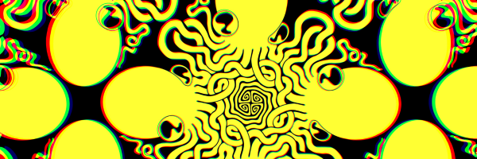

  

    
     
  

 

-------------------------------------------------
Nov 16 (later later) 
  ugh so flipping tired. mañana!
I actually don't even like computers that much. I have a thinkpadz16, Steamdeck, and a number of android phones/devices mostly pixels (4a, 5, 6 (I think)) + 10
I like privacy first graphene and all that. 

- Sol review markdown
- sleep

I actually dont plan on using this platform too much until I have something to make or share. 
I like to log my progress. ie. Maps.

simple geotagging and a clean ui would be terrific to log hotspots. 
We see 100+ but even w the most energy theres not too many we can reach.
If there are that many there is need idk. 

- the reason I wrote a bunch of words is to create legit libraries. Those were for fun but there are structures I want to have
- ex. Library - CityFHEPS requirements timelines.
- Library - Harm Reduction
-   -  drugs  (effects, addiction, treatments, vulnerability factors, long term deterioration and direction of care).
    -  Housing (food access, transit, growth opportunities, etc.)
    -  other factors 

------------------

[Blog](https://github.com/solroj0/Blog/)   
[Words](https://github.com/solroj0/Words/)  

-- Sol write a script to publish most recent blog into the /https://github.com/solroj0/solroj0/README.md
 
-- also a print out of most recent and global stats from /Words 

  Important .. add examples of previous automation
  1. remote-desktop-OBS-miro-+recorded.media , and auto-captioning-and-translation
- I had a computer running in my home I automated to open a series of programs in conjunction to create a drop-in environment where i could join from discord anytime on any device.
- Additionaly, I made it turn my words into close captions that were reproduced on a virtual webcam through OBS. The captions auto scrolled and auto translated using a local llm (dont remember terminology).
- Repetitive human input tasks were automated for ease of labor

  2. scripted.comms
  Texting, required for previous roles. Scaled up to reach many individually with preset messages related to scheduling and programming (lectures grd 9-12).
- Current goal: ability to text/email an address to log and automate input/output. Scale goal to take any input from preset numbers. Ie. team text this number and your stuff will go through a private sanitized environment

  
- 
^ imp to add for /Words -
 

  Sol: ok... so much to do so much to add. !!! on paper draw out all projects ever done, then create structure w simple descriptions and "here's how I did it"
Eventual goal is to recover previous workspace pipeline allowing interface and automation from always-on/accessible phone (text, email, discord(audio)) to desktop(headless ok)

  manual blog entry below ..
 

  Nov 16 (later) 
  heliocentric
  
  Nov 16
  Ethics and data. Who judges what is just. 
  Reality, conscience, meta/physics. When and where does consciousness exist. How do we relate?
  Idolatry, false idols - what virtues?
  ignoramus improbable impious impugnan immediate illicit immisive impressive immersive isolated imaging imaginary
emotive empiric effervescent emporium empanda
emenate emasculate emputado enbotellar
emission emotions emulate hemisphere hectare hesitant hasten half halitosis hammock hammerhead halflife hysterical hypochondriac histrionic hermeneutical hepatitis humanist harm reduction 
restoration rapture responsibilities respite rapport repentance relief
ramification rapidity rally tally smally jolly funny bunnie sunny money honey runny 
explosives extermination eradication evisceration emaciation 
endeavor enroute entourage entender estirar emprender
excess embarass expose exalt elucidate externalization
empathy elevate exonerate effigy elliptical eccentricity ephemeris equator espacial spatial sassy sass sazón satiating statistical stereoscopic suspicious sufficient satisfactory sinusoidal syphonic symphony sepsis separate savagery salaciousness solenoid centroid asteroid astroseismology astronaut nautical navigation narrowness numb nimble graviton garrish gateway gale gallon gallery gust gamine galant galactic extraneous homogenized hustle horchata jamaica jumex juguito juguetito joya firm finality terminus origin zero absoluteness climatic cacophonous clarity catharsis clandestine conclusion clearly commonality campechana calabaza cacahuate camaron caramelo cansadisimo callado calenturientx capaz
ending enough exhausting expectations
enough enough
¡éxito! exposure efficient epicurean erudite emphasized daft dart damascus denebola datura diethylamide darma drama daredevil despotic denunciation dismissive diligence destination duplicity multiplicity fluidity freedom fastidiousness fashionista fabulous fantastic pharmaceuticals festivities felicidad femtometer fractals fascination future familiar fester frenetic finite fine fidelity fibonacci chalé chanflé chamba churros chamoy chulada champion champiñon chuchuluco chusma chinflón chamorro chesco chido chipote chipotle chín chupete cháchara 
  impossible incessant indomitable impolite impatient illusive improper illuminating egotistical excessive incisive immaculate inaccurate    estrés estorbo estrógenos estrenar esotérico estereo 
  Libraries: drugs; methamphetamines amphetamine barbiturates opioids inhalants MDMA ecstasis fentanilo foco piedra peyote ayuhasca marihuana cocaina serotogenic triptamine dimethyltryptamine ketamina psylo psycho 
 
  <i> deserving developed </i>
  Open Source Transparent Accessibility Design 
  vexatious abstruse
  boom
  dysgenicall aspinose bathysmal avaunt dunt cenotaph 
 
  Nov 15
  Phew. For so long I have felt I am seeking a path. I keep collecting knowledge and experiences, but nothing draws me long. After half a year is when I usually leave.

  hazed

Now I've been doing this for 9 months. A year is right around the corner. I got serious. I treated it lightly before. I love it now. 
My work is to help others - the most vulnerable and ignored. It sucks that so many in this field treat it like a paycheck. 
It's a nonprofit. You're supposed to want to go above and beyond.

I have the best leadership I've ever worked with. So much so I am worried for the future when that changes. But, like much else, it is what you make of it. The absence of someone great should inspire you to fill that void.

Nov 15 (late)  
Optimistic. So much I want to do. first phase; create skeleton of all great works and minor too. Want to add - words.of.power, maps (project).
additional; not as important; recipes, inventory (tools and library).
- need sleep, then abtract on paper, scan mail upload here

 

   
  

    
     
  

