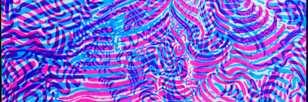

  

    
     
  

 

[Blog](https://github.com/solroj0/Blog/) - [Words](https://github.com/solroj0/Words/) - [Libraries](https://github.com/solroj0/Libraries) - [Figures](https://github.com/solroj0/Figures)

-------------------------------------------------
<b> Nov 16 </b> 
  ugh so flipping tired. mañana! 
  I actually don't even like computers that much. I have a thinkpadz16, Steamdeck, and a number of android phones/devices mostly pixels (4a, 5, 6 (I think)) + 10 
  I like privacy first graphene and all that. 

I'm really doing all this for fun. I don't expect to use any of it for work (other than the map). I'd be happy just saying bananas and having it logged by time (location would be awesome). One of the best practices we have in outreach is speaking about the people, their names, and their qualities. If you could see your spoken words as they leave your mind - it would really enhance your output (maybe). I used voice keyboard almost all today w the mic from my Momentum5s, I have some OpenRunPro2Shoks which also capture voice very clearly (for busy Manhattan).

I want to study and make a difference and see what I come up with. I really dont want to be a programmer to be honest. I just like to learn. - I have extensive experience learning systems (beta testing, breaking games / exploit discovery, speedruns). 

Im already kinda bored reading all this hahaha. Need paper. Goodnight.
I like to organize and I think the best kind of organizing is to learn how to organize people. <i> Clearly </i> I need to polish my coarse edges still. Working on it.

 

---

  Possible Goals / Ideas
  Workspace pipeline allowing interface and automation from always-on/accessible phone (text, email, discord(audio)) to desktop(headless)

 
TO DO
  - Sol review markdown
  - sleep
  - Sol write a script to publish most recent blog into the /https://github.com/solroj0/solroj0/README.md
  - also a print out of most recent and global stats from /Words
  - migrate away from web-ui
  - paper draw out all projects ever done, then create structure w simple descriptions and "here's how I did it"
  - setup file versioning and adequate codespace

 
  I actually dont plan on using this platform too much until I have something to make or share. 
  I like to log my progress. ie. Maps.

  simple geotagging and a clean ui would be terrific to log hotspots. 
  We see 100+ but even w the most energy theres not too many we can reach.
  If there are that many there is need idk. 

---

<b> Words </b> the reason I wrote a bunch of words is to create libraries. Those were for fun but there are structures I want to have. 
- ex. Library - CityFHEPS requirements timelines.
- Library - Harm Reduction
-   -  drug types (effects, signs of use, addiction, treatments, vulnerability factors, long term deterioration and direction of care)
    -  Housing opportunities (services, food access, transit, growth opportunities, accesible labor, etc)
    -  other factors 
- Library - personal accomplishments / portfolio

---

<b> Previous Examples of Automation </b>
  1. remote-desktop-OBS-miro-+recorded.media , and auto-captioning-and-translation
- I had a computer running in my home I automated to open a series of programs in conjunction to create a drop-in environment where i could join from discord anytime on any device.
- Additionaly, I made it turn my words into close captions that were reproduced on a virtual webcam through OBS. The captions auto scrolled and auto translated using a local llm (dont remember terminology).
- Repetitive human input tasks were automated for ease of labor

  2. Scripted communications
  Texting, required for previous roles. Scaled up to reach many individually with preset messages related to scheduling and programming (lectures grd 9-12).
- Current goal: ability to text/email an address to log and automate input/output. Scale goal to take any input from preset numbers. Ie. team text this number and your stuff will go through a private sanitized environment

  3. Simple database design (paper to digital simple logic) 
- Regents exam, categorized each question by topics covered, input correct/incorrect, output performance heatmaps, histograms, a bunch of plots. Project for fun to help determine from our classroom what topics we needed to work on.
-- self-guided fast results vs. waiting a year+ for some large standarized obscured result
  -- will add examples here

---
Additional Experiences
- Project based field observation (birds, water sampling, climate conditions, restoration sites, nurseries)
- Mapping (water features, bathrooms, staging areas, survey zones) - QGIS and ArcGIS
>   attended some impressive symposiums where they used pattern recognition to map all invasive fauna from satellite imagery. Extremely useful to optimize areas of focus. - who knows, we have people on the field and a database that could produce some fun numbers and figures (?) 
- Data reduction
-- Trimming, flatfielding, noise normalization, normalized outputs (relative photometry)
- Data presentation
-- figures you know fancy looking stuff 
- Training Materials / Instructional Design
-- I'm typically not satisfied learning something w mastery unless others are able to learn it an easy to access and understand way (I was a terrific teacher).

- For the majority of Astro and Physics I used Fortran, some Python, I have moderate familiarity w R. It's been some time but I can produce stuff w LaTeX. I like Bash and remote access stuff.
- I am very good at taking complex tasks and simplifying them
- I also really enjoy game design. Super tic tac toe (super gato) super fun.

 

   
  

    
     
  

