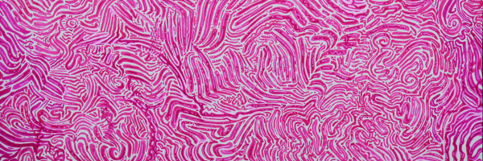

  

    
     
  

 

[Blog](./Blog/)   [Words](./Words/)  

Nov 15

Phew. For so long I have felt I am seeking a path. I keep collecting knowledge and experiences, but nothing draws me long. After half a year is when I usually leave.

Now I've been doing this for 9 months. A year is right around the corner. I got serious. I treated it lightly before. I love it now. 
My work is to help others - the most vulnerable and ignored. It sucks that so many in this field treat it like a paycheck. 
It's a nonprofit. You're supposed to want to go above and beyond.

I have the best leadership I've ever worked with. So much so I am worried for the future when that changes. But, like much else, it is what you make of it. The absence of someone great should inspire you to fill that void.

 

   
  

    
     
  

